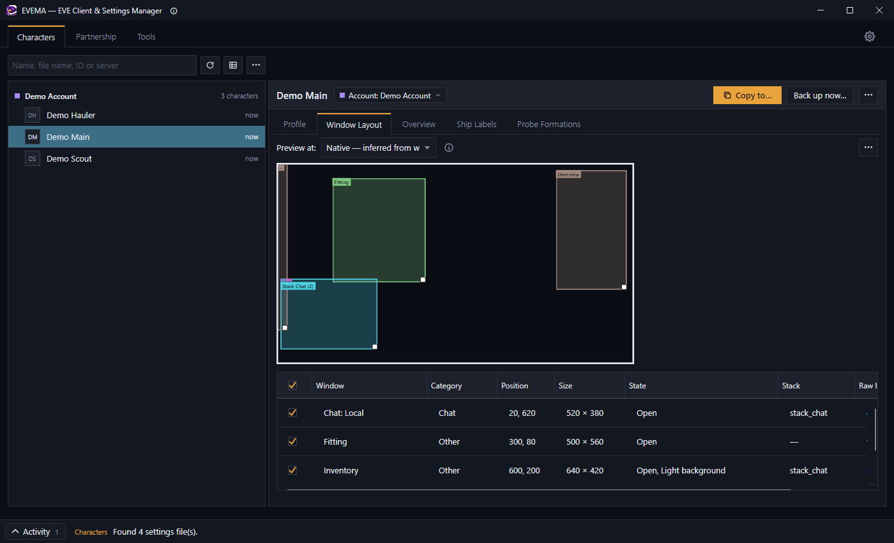
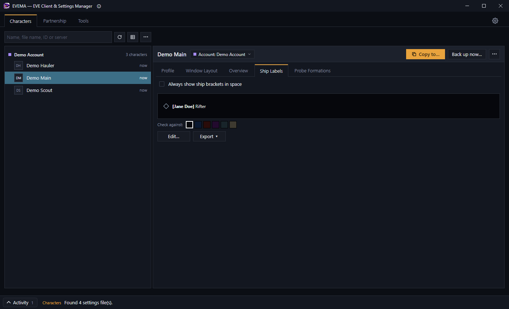
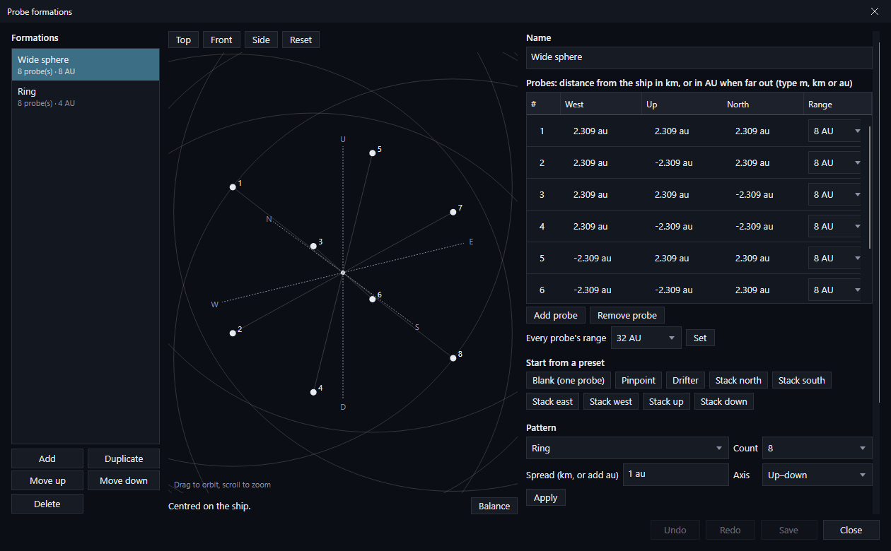
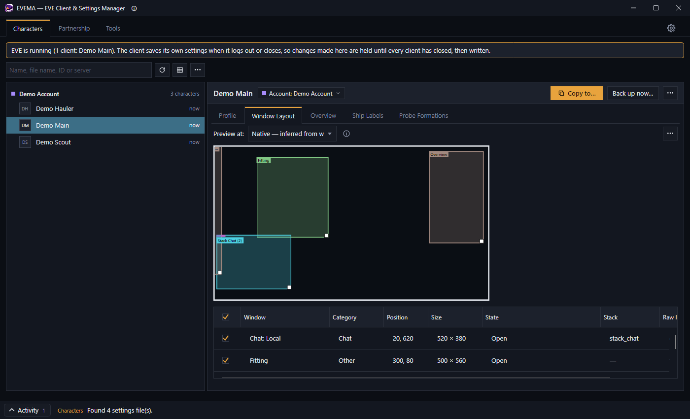
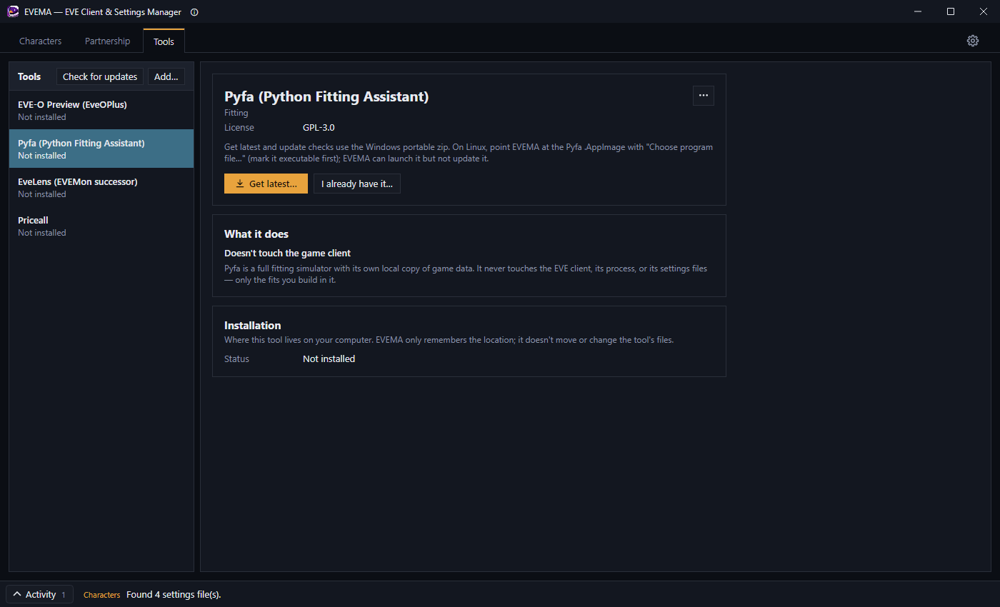

# EVEMA

EVEMA is a desktop settings manager for EVE Online. It reads your local settings files and lets you preview and copy window layouts and overview settings between characters, restore automatic backups, and run the Partnership / giveaway tools against your combat logs. It runs on Windows, macOS and Linux.

EVEMA is a fan tool and is not affiliated with or endorsed by Fenris Creations (FC, formerly CCP Games). See [THIRD-PARTY-NOTICES.md](THIRD-PARTY-NOTICES.md).

**What it does, in short:**

- See each character's window layout, ship label and public profile without logging in.
- Copy a whole settings file, or just the sections you pick, from one character to one or many others, with a preview of every change first.
- Edit window positions, ship labels and probe formations directly. Every change is backed up first and can be restored.
- Keep community tools such as EVE-O Preview and Pyfa installed, launched and up to date, with checksums verified.

EVEMA never modifies the client, reads its memory or automates anything. See **[what EVEMA does and won't do](docs/what-evema-does.md)** for the full list, including exactly what it connects to.

More screenshots

| | |
|---|---|
|  |  |
|  |  |

Screenshots use demo data. New to EVEMA? The **[user guide](docs/user-guide/README.md)** walks through first launch, copying and editing settings, backups and the Tools tab.

## Download / install

Grab the archive for your system from the [Releases page](../../releases). Every release lists a `SHA256SUMS` file so you can check your download. Builds are self-contained: you do not need to install .NET.

| System | File | Install |
| --- | --- | --- |
| Windows (64-bit) | `EVEMA-<version>-win-x64-setup.exe` | Run it. Installs for you only (no administrator rights), with a Start menu entry and an uninstaller. |
| Windows (64-bit), portable | `EVEMA-<version>-win-x64.zip` | Unzip anywhere and run `EVEMA.exe`. |
| macOS, Apple silicon | `EVEMA-<version>-osx-arm64.zip` | Unzip, drag `EVEMA.app` to Applications. |
| macOS, Intel | `EVEMA-<version>-osx-x64.zip` | Same as above. |
| Linux (x64) | `EVEMA-<version>-linux-x64.AppImage` | Make it executable (`chmod +x`) and run it. |
| Linux (x64), tarball | `EVEMA-<version>-linux-x64.tar.gz` | Extract, then run `./EVEMA`. |

**macOS first launch.** The app is not notarized, so macOS will refuse a normal double-click the first time. Right-click `EVEMA.app`, choose **Open**, then confirm (or allow it under System Settings → Privacy & Security → Open Anyway). You only need to do this once.

**Linux app menu.** The archive includes `evema.desktop` and `evema.png`. To add EVEMA to your menu, set `Exec=` and `Icon=` in the `.desktop` file to absolute paths and copy it to `~/.local/share/applications/`.

**Windows SmartScreen.** Windows may warn about an unrecognised app; choose **More info → Run anyway**.

EVEMA looks for your EVE settings in the usual place for each system (including Steam/Proton and Wine prefixes on Linux). If yours lives elsewhere, pick the folder in EVEMA's Settings (the gear at the right end of the tabs). Then follow [Getting started](docs/user-guide/getting-started.md).

## Feedback

Found a bug or have an idea? [Open an issue](../../issues/new/choose). To report a security problem privately, see [SECURITY.md](SECURITY.md).

EVEMA is closed source, so this repository holds the releases, the user guide and the issue tracker rather than the code.

## License

EVEMA is free to use under its [license agreement](LICENSE): download it from the [Releases page](../../releases), use it on as many of your own computers as you like, and share the link rather than the files. Third-party components and their licenses are listed in [THIRD-PARTY-NOTICES.md](THIRD-PARTY-NOTICES.md).
