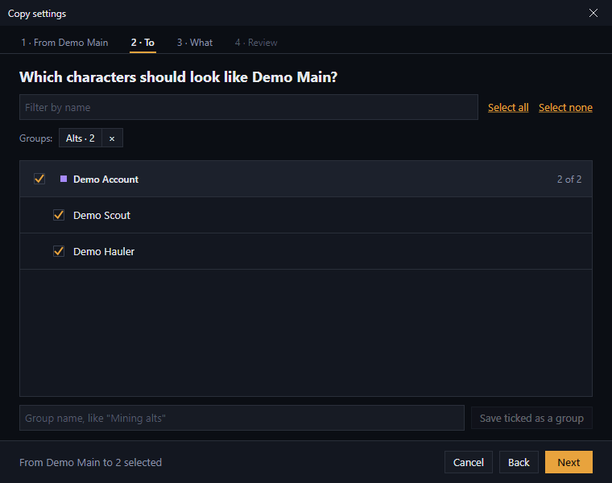
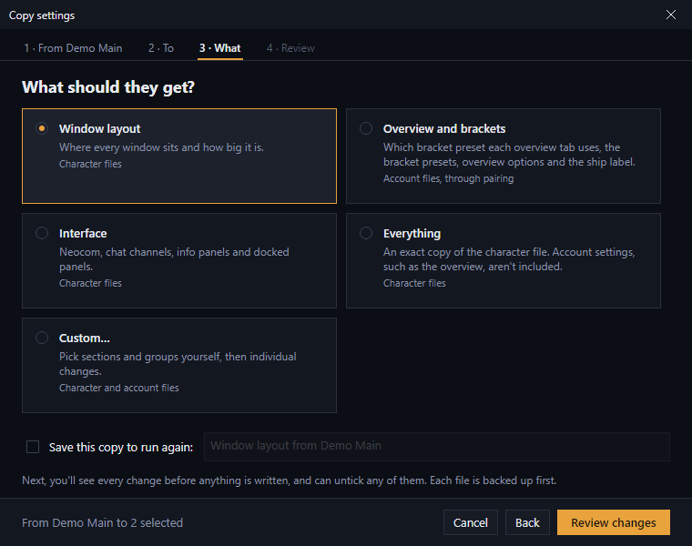
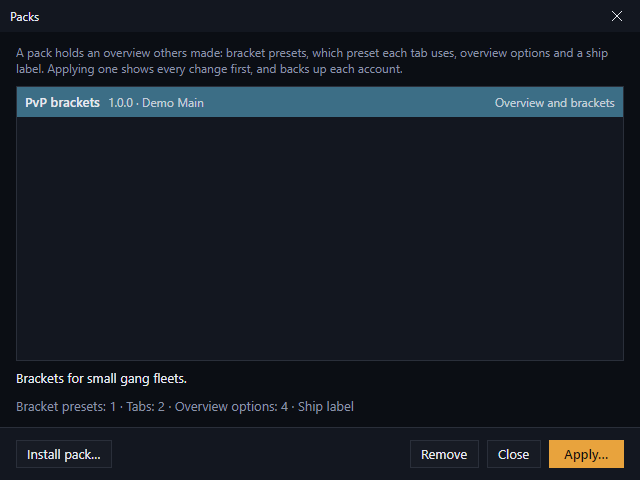

# Copying settings

Copying starts from the selected file in the **Characters** tab: click **Copy to…** above its details (or right-click the row and choose **Copy to…**, or drag the row onto the character or account you want to copy to). Export and import are under the **⋯** button beside it. Whatever you pick, EVEMA shows what will change before writing anything, and backs up every file it's about to change.

**Close every EVE client first.** The client saves its own settings when it logs out, which would undo your copy. If a client is open, EVEMA holds the copy back and writes it once the client closes; see [Changes while EVE is running](backups-and-eve-running.md#changes-while-eve-is-running).

## Which do I want?

| You want to… | Use |
| --- | --- |
| Make one or more characters look like another: windows, overview, interface, or all of it | [Copy settings](#copy-settings) |
| Keep a copy of your setup, move it to another computer, or share it with a friend | [Export and Import](#export-and-import-a-settings-file) |
| Share your overview in the game's own format, for anyone to import in the client | [In game (.yaml)](#export-your-overview-for-the-game) |
| Share your bracket presets and overview options with other EVEMA players, or apply theirs to several accounts | [Overview packs](#overview-packs) |
| Move everything to a new computer | [Export everything](#move-your-whole-setup-to-another-computer) |

Copies only go between files of the same type: character to character, or account to account.

## Copy settings

**Copy to…** opens the **Copy settings** window, which asks three questions and then shows you every change:

1. **From:** the file you selected. Click **1 · From** to pick a different one.
2. **To:** tick the characters (or accounts) that should get the settings. Characters are listed under the account they're [paired](getting-started.md#3-pair-each-character-with-its-account) with, with any unpaired ones last; tick an account's box to tick all of its characters. **Filter by name** narrows a long list, and **Select all** / **Select none** act on what's shown. Rows you'd already selected in the list with **Ctrl+click** (**Cmd+click** on macOS) or **Shift+click** start ticked.
3. **What:** pick what they should get:
   - **Window layout:** where every window sits and how big it is.
   - **Overview and brackets:** which bracket preset each overview tab uses, the bracket presets, overview options and the ship label. These live in the account file, so this needs the characters to be paired. It copies between their accounts, each account once.
   - **Interface:** Neocom, chat channels, info panels and docked panels.
   - **Audio, camera and graphics** (accounts only).
   - **Everything:** an exact copy of the whole file. For a character that's the character file only; account settings, such as the overview, aren't included.
   - **Custom…:** choose sections and groups yourself (see below).
   

4. **Review changes** opens the review. **Everything** asks you to confirm overwriting the files, with a summary of what will change. Every other choice opens the **Copy sections** window with that choice ticked: it lists every change, grouped by section and labelled with its file. Expand a section to see each change, untick any you don't want (**Select all** / **Select none** help), or tick more. Then click **Copy**.

Each file gets its own backup and its own write. If one fails, the others still go ahead, and the status bar names the ones that failed. Right after a copy, **Undo** in the status bar puts every file back.

### Groups

If you copy to the same characters again and again, keep them as a group (once you have one, **Show** above the Characters list can narrow the list to it, too). On the **To** step, tick them, type a name (say "Mining alts") in the box at the bottom, and click **Save ticked as a group**. Next time, the group shows above the list: click it to tick everyone in it, or click its **×** to forget it. Groups are only kept in EVEMA.

### Saved copies: the same copy again in one click

On the **What** step, tick **Save this copy to run again** and give it a name (EVEMA suggests one, such as "Window layout from Main"). After you rearrange your main's windows, you don't need to go through the steps again: select the main, choose **⋯** → **Saved copies** (or right-click it), pick the copy and **Run…**. It goes straight to the review, so you still see every change before anything is written. **Delete** forgets the saved copy; nothing it copied is touched.

If you ticked exactly the members of a group, the saved copy remembers the group rather than the characters, so adding a character to the group later adds it to the copy too.

### Sections and groups

**Custom…**, and the review for every choice except **Everything**, list these.

- **Between characters:** the **Window layout**. If the characters are paired with accounts, their accounts' overview sections are offered too.
- **Between accounts:** **Overview tabs' bracket presets** (which preset each tab uses), **Bracket presets**, **Overview flags** and **Ship label**.

Overview tabs and bracket presets are matched **by name**, not by position. Nothing is created on the destination: a tab that doesn't exist there is reported as not matched rather than added.

Under those sections, the window lists more groups of settings. With **Custom…**, each is ticked to begin with only if it's on by default below and would change something; with the other choices, only that choice's sections and groups start ticked:

| Group | File | On by default | What it copies |
| --- | --- | --- | --- |
| **Overview (everything)** | account | no | The whole overview, columns and colours included. Ticking it unticks the four overview sections above, and the other way round. |
| **Probe formations** | account | yes | Your saved probe formations and scanner filters. The client's own temporary formation on the destination is kept. |
| **Suppressed dialogs** | account | yes | Your "don't show this again" choices. |
| **Audio** | account | yes | Sound settings. |
| **Camera and graphics** | account | yes | Camera, space mouse and graphics effects. |
| **Market and contracts** | account | yes | Market and contract search filters. |
| **Module slots and linked weapons** | account | no | Slot order and weapon groups. Usually set up per character, so it's off. |
| **Window tab groups** | account | yes | Which tabs are grouped and selected in windows. |
| **Windows (raw)** | character | no | The whole windows section. **Window layout** is the usual way to copy layouts. |
| **Neocom** | character | yes | Your Neocom buttons. |
| **Chat channels** | character | yes | The channels the character has joined. |
| **Info panels** | character | yes | Which info panels are shown where. |
| **Docked panels** | character | yes | Docked panels such as the skill planner and the map. |
| **Search history** | both | no | Recent searches. |

A group makes the destination's settings in it **the same as the source's**. So a setting the source doesn't have is removed, and the change list shows it as **Removed**. Untick it to keep it. Private and player chat channel settings, and cached values such as market prices, are never copied.

Keybinds can't be copied section by section yet. Use a whole-file copy for those.

## Export and import a settings file

Export saves settings to a JSON file that you can keep as a snapshot, move to another computer, or share.

- **⋯ (or right-click) → Export → Export all…** saves everything EVEMA can copy by section. For a character, that's its window layout plus its paired account's overview settings.
- **⋯ (or right-click) → Export → Export sections…** lets you pick sections and individual changes first.

To apply one, select the file to change and choose **⋯** → **Import…** (or right-click it). You get the same preview, per-change ticking and backup as a section copy. Importing onto a character applies the window layout to the character and the overview settings to its paired account.

## Export your overview for the game

**⋯ (or right-click) → Export → In game (.yaml)…** saves the account's overview (for a character, its paired account's) as the same `.yaml` file EVE's own Overview Settings → Export creates. Import it in the client from **Overview Settings**. It's the format players already use to share overview packs.

The **Ship Labels** tab has the same export under **Export ▾**, plus **Step by step (.txt)…**, which writes instructions for re-entering the label by hand in EVE's Ship Label editor.

A few overview colours EVEMA can't match to the game's palette are left out; the status bar says which, and the game uses its default colour for them.

## Overview packs

A pack is a small `.evpack` file holding an overview setup: bracket presets, which preset each overview tab uses, the overview options and the ship label. It's for sharing with other EVEMA players, and for keeping a setup you apply to accounts again and again.

**To make one**, select an account (or a character paired with one), open its **Overview** tab and choose **Share ▾ → As an EVEMA pack…**. Give it a name, the author name other players will see, and a version, then untick anything you'd rather leave out. Your account's name and IDs never go into a pack.

**To use one**, choose **⋯ → Packs…** above the Characters list:

- **Install pack…** checks a `.evpack` file and keeps a copy in EVEMA, so you can apply it again later without the file. A file that's damaged, changed since it was made, or holds anything other than overview settings is refused.
- **Apply…** asks which accounts to apply it to (the selected one starts ticked), then **Review changes** shows every change for each account, as Import does. Each account is backed up first, and while EVE is running the changes wait until it closes.
- **Remove** forgets an installed pack. The file you installed it from isn't touched.

A pack holds only settings. EVEMA applies it with its own code, and nothing in a pack ever runs.

## Move your whole setup to another computer

**⋯ → Export everything…** (above the Characters list) saves your whole setup in one `.zip`:

- every character and account settings file, and `prefs.ini`, of every EVE install and profile on this computer
- EVEMA's account names, character names, pairings and state names
- EVEMA's backups too, if you tick **Include EVEMA's backups**

On the other computer, run each EVE client you use once, so its settings folder exists. Then choose **⋯ → Import everything…** and pick the archive. EVEMA checks every file against the checksum saved with it, and refuses the whole archive if anything was damaged or changed.

The import window lists every settings file and how it compares with what's already there:

- **New** files are ticked, ready to import.
- **Different here: replace?** files are not ticked. Tick the ones you want replaced; each is backed up first.
- **Already the same** files are left alone.
- **No install of this server** files can't be imported until you've run that client on this computer.

Files go to the same server and profile they came from, even though EVE's install folder has a different name on each computer. If a computer has two installs of one server, the most recently used one gets the files.

Names and pairings are added where this computer has none. Where both computers have a different name for the same character or account, you choose once whether to keep this computer's or take the archive's.

Settings files hold your character and account IDs, chat channel IDs and other details about how you play. Only give an archive to someone you'd show your settings to.

## If a copy went wrong

Straight after a copy, click **Undo** at the right of the status bar to put every file it changed back. Later on, every copy still backed up the destination first: select the file, choose **⋯** → **Restore backup** (or right-click it), and pick the time from before the copy. See [Backups](backups-and-eve-running.md#undo-a-change-restore-a-backup).
