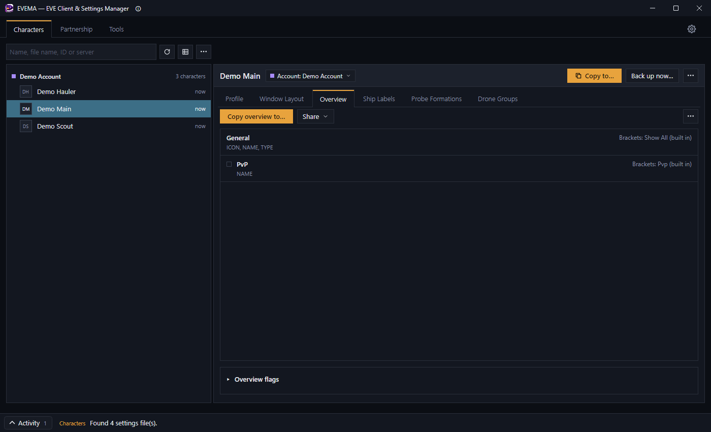
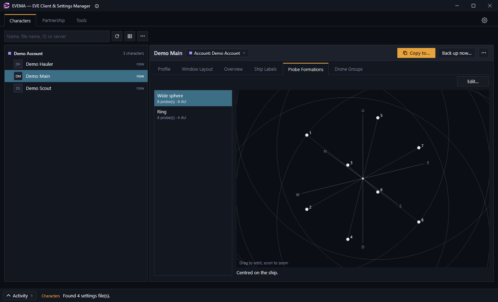
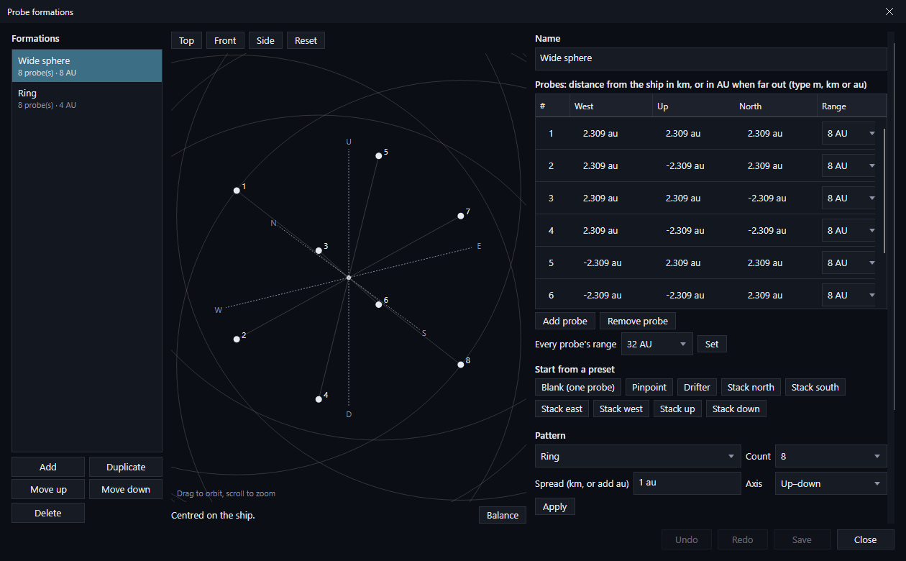
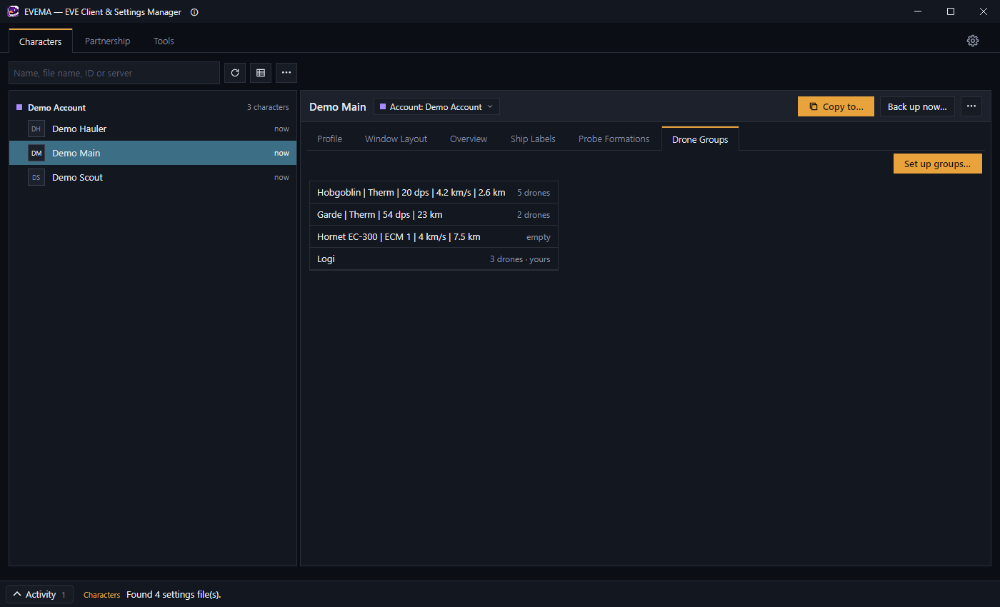
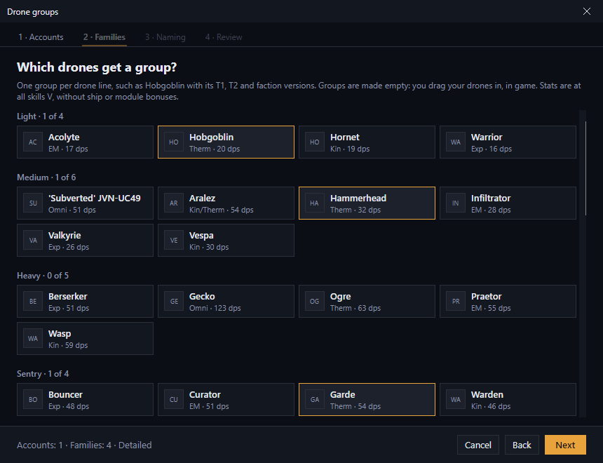
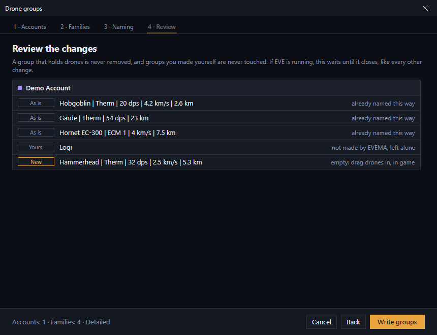

# Editing settings

EVEMA can change some settings directly, without copying from another character. Select a character or account in **Characters**, then use the detail tabs on the right.

Every edit backs up the file first, and every edit waits for EVE to close if a client is running. See [Backups, and changes while EVE is running](backups-and-eve-running.md).

The ship label and probe formations live in the **account** file. If you select a character, the **Ship Labels** tab shows its [paired account](getting-started.md#3-pair-each-character-with-its-account), and your edits change that account, so every character on it gets them.

## Overview

The **Overview** tab lists the account's overview tabs, each with its colour, its bracket preset and its columns. Built-in presets are named in words, such as "Show All (built in)". You change your overview in the game; here you copy it and share it:

- **Copy overview to…** opens [Copy settings](copying-settings.md#copy-settings) with **Overview and brackets** already chosen.
- **Share ▾ → For the game (.yaml)…** saves it as the same `.yaml` file the game's own Overview Settings export, for anyone to import in the client.
- **Share ▾ → As an EVEMA pack…** saves it as a [pack](copying-settings.md#overview-packs) other EVEMA players can apply to their accounts.
- **Overview flags** (at the bottom, folded away) are the overview's on/off options.
- **⋯ → Edit presets…** opens the bracket preset editor as its own tab, for anyone who wants to edit presets outside the game.

## Window layout

The **Window Layout** tab draws every window at its saved position and size, with a table of the same windows below.

- **Preview at:** shows how the layout would look at another resolution. EVE pulls windows back on screen when you move to a *smaller* resolution, and this preview copies that. Moving to a *larger* resolution doesn't rescale anything, so the layout renders small and out of place, the same as in game.
- **Move or resize a window:** drag it, or drag its edges, on the canvas. This only works with **Preview at:** set to the native resolution.
- The **Preview** column in the table chooses which windows are drawn; its header checkbox shows or hides them all. It doesn't change the file.
- Once you've moved something, a bar appears under the table: **Undo** steps back one change, **Discard** drops every unsaved change, and **Save changes** writes them.
- **⋯** → **Export window layout…** saves some or all of the windows to a file, and **Import window layout…** applies such a file to the selected character. Private conversations, agent windows and windows known only by a number are left out of exports by default, because they reveal who you talked to or mean nothing to another character. Import only adds or overwrites positions: it never removes a window that's already saved.
- **⋯** → **Restore backup** puts back an earlier version of this character's file.

A window outlined in red hangs off the edge of the screen at that resolution.

## Ship label

**Always show ship brackets in space** (at the top of the **Ship Labels** tab) shows every ship's label all the time, not only when selected. It's a client launch preference stored in `prefs.ini`, not part of the account, so it applies to every account in this settings profile and takes effect after you restart the client.

Below it, the tab shows a preview of the account's ship label. **Edit…** opens the editor:

- The label is a list of **segments** (for example corporation, alliance, pilot name, ship type and ship name), plus line breaks. **Add segment**, **Add line break**, **Up**, **Down** and **Remove** arrange them.
- For each segment you can set it **Enabled**, add **Pre-text** and **Post-text** (such as brackets around a ticker), and choose a **Color**, **Style** and **Font size**. Leaving a colour unchecked, or a style as a dash, uses the client's default.
- **Save** writes the label; **Cancel** drops your changes.

**Export ▾** saves the label for use elsewhere: **In game (.yaml)…** writes the whole overview, label included, as a file you can import from the client's Overview Settings, and **Step by step (.txt)…** writes instructions for typing the label into EVE's own editor by hand.

## Probe formations

Your saved probe formations live in the **account** file. Select an account, or a character paired with one, and open the **Probe Formations** tab. It lists the formations; select one to see it around your ship, with each probe's range and how far off-centre it is.

To change them, click **Edit…** (or right-click the account and choose **Probe formations…**). The editor opens in its own window:

- **Formations** (left): **Add**, **Duplicate**, **Move up**, **Move down** and **Delete**. Select one to edit it, and type its name under **Name**.
- **Preview** (middle): the formation around your ship, with North/South, West/East and Up/Down axes. Drag to turn it, scroll to zoom, or pick **Top**, **Front**, **Side** or **Reset**.
- **Probes** (right): each probe's distance from the ship to the West, Up and North (negative for East, Down and South), and its range. Type plain numbers for km, or add **m** or **au**; far-out positions are shown in AU. **Every probe's range** sets them all at once. A formation holds up to 8 probes.
- **Start from a preset** and **Pattern** replace the selected formation's probes. Patterns (ring, line, sphere, pinpoint) take a count, a spread and an axis. Presets such as **Drifter** and the **Stack** ones are close-range layouts, measured in km.
- **Transform** scales, rotates, mirrors or moves the whole formation.
- **Undo** and **Redo** step through your edits, and **Save** writes them, with a backup, like every other change.

**Keep formations centred.** In game, a formation is placed around the probes' current average position, not around your ship. So a formation whose probes don't average out on the ship drifts that far every time you apply it. Below the preview, EVEMA tells you how far off-centre a formation is, and **Balance** adds or moves one probe to centre it.

If the file changes while the window is open, for example because EVE saved it when you logged out, EVEMA offers **Reload**. Closing with unsaved changes asks first.

## Drone groups

Drone groups are the folders in your drone bay and drones-in-space list. They live in the **account** file. Select an account, or a character paired with one, and open the **Drone Groups** tab to see its groups and how many drones each holds.

**Set up groups…** makes a group for each kind of drone you pick, named from its stats, for example `Hobgoblin | Therm | 20 dps | 4.2 km/s | 2.6 km`. The groups are made **empty**: you drag your drones into them in game, since only the game knows which drones you own. The wizard has four steps:

1. **Accounts**: tick every account that should get the groups. The account you started from is ticked already, and each account shows how many groups it has now.
2. **Families**: pick the drones, grouped as Light, Medium, Heavy, Sentry, Electronic warfare, Hybrid, Logistics and Industry. A family is one line of drones, such as Hobgoblin with its Tech I, Tech II and faction versions. The numbers are the Tech II drone's at all skills V, without ship, module or implant bonuses.

   

3. **Naming**: **Detailed**, **Compact**, **Plain**, or **Custom** with your own pattern. A pattern uses `{name}`, `{damage}`, `{dps}`, `{speed}`, `{range}` and `{effect}`, and must start with `{name}`. A part in square brackets drops out when a drone has nothing for it, so `{name}[ | {speed}]` gives a sentry no speed. The preview shows the names before anything is written.
4. **Review**: what happens to each group on each account, then **Write groups**.

   

When you run it again, the drones that already have groups start ticked, and EVEMA finds its groups by their names:

- A group for a drone you still pick is **renamed** to match the new style, and keeps its drones.
- A group for a drone you no longer pick is **removed** only if it's empty. If it holds drones, it's **kept**.
- Groups you made yourself, whose names don't start with a drone's name (such as `DPS` or `Logi`), are never touched.

Every account is backed up first, and while EVE is running the groups wait until it closes, like any other change.
